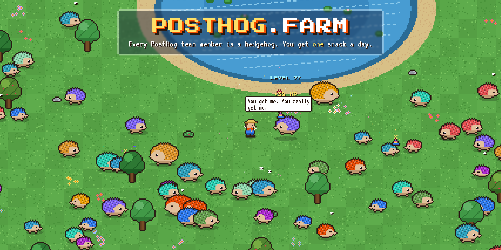

# 🦔 PostHog Farm

[](https://posthog.farm)

<p align="center"><b><a href="https://posthog.farm">posthog.farm</a></b></p>

A tiny pixel-art game where every PostHog team member is a hedgehog. Walk around the farm,
meet your colleagues in their true form, and feed them. You get **one snack per day**, so
choose wisely.

Runs entirely on Cloudflare: Workers, Static Assets, a Durable Object and the Rate Limiting binding.

## The game

- **236-ish hedgehogs**, one per PostHog team member, pulled from the same API posthog.com
  uses for its people page. Each is tinted with their profile colour, and gets rounder as it
  levels up (SMOL BEAN → ROUND BOI → CHONK → ABSOLUTE UNIT → OH LAWD THEY COMIN).
- **One snack per IP per day** (resets at 00:00 UTC), enforced by the server.
- **8 snacks** with different effects: pineapple pizza is +25 XP for believers and +2 for haters
  (it reads their actual `pineappleOnPizza` profile field), the feature flag is a 50/50 for
  0 or +30 XP, the coffee gives the hedgehog zoomies, the mystery box might be a sock.
- **Hogiversaries**: hedgehogs on their PostHog work anniversary wear a party hat, get
  **1.5x XP**, and are listed in the bottom-left banner. When nobody is celebrating, the banner
  says so and shows the next party.
- **Starving** hedgehogs (not fed for 4+ days) also give 1.5x XP.
- Hedgedex (search, filter by team), rankings (chonkiest, hungriest, teams, live snack log),
  21 trophies, streaks, a compass that orbits your farmer, whistling hedgehogs over, a minimap,
  day/night with fireflies, hedgehog small talk, and chiptune music + sound effects.
- When two hedgehogs share a first name, they're shown with their last initial (Ben H, Ben V).
- Works on desktop (keyboard/mouse) and mobile (tap to walk, pinch to zoom).

Everything is drawn in code: no image assets apart from avatars (pixelated in the browser) and fonts.

## How it works

```
                    ┌──────────────────────── Cloudflare ────────────────────────┐
 browser ──────────▶│ Worker (worker/index.ts)                                    │
   │  static files  │   ├─ Static Assets: the game (Vite build of src/)           │
   │  /api/*        │   ├─ FEED_LIMITER: Rate Limiting binding (burst protection) │
   │                │   └─ BARN: Durable Object (worker/barn.ts, SQLite)          │
   │                │        XP, snack locks, feed log                            │
   │                └─────────────────────────────────────────────────────────────┘
   └─ avatars ─────▶ Cloudinary (resized on the fly, pixelated client-side)
```

| Piece | What it does |
| --- | --- |
| `scripts/fetch-hedgehogs.ts` | Fetches the team from the Squeak (Strapi) API with the same rules as posthog.com's `/people` page: `startDate <= today`, on at least one team, excluding the "PostHog AI" profile. Writes `shared/roster.json` (git-ignored). Runs automatically before every build. |
| `shared/game.ts` | Game rules shared by server and client: roster, foods, XP, levels, hunger, hogiversaries. The server decides every outcome; the client only displays it. |
| `worker/index.ts` | The API: `GET /api/farm` (edge-cached for 5s), `GET /api/me`, `GET /api/hedgehogs/:id`, `POST /api/feed`. Everything else is served by Workers Static Assets. |
| `worker/barn.ts` | **The Barn**: one global SQLite-backed Durable Object holding hedgehog stats and the daily snack locks. |
| `src/` | The game client. Plain TypeScript and canvas, no framework. |
| Cloudflare Workers Builds | Builds and deploys on every push to `main`. A Cron Trigger on the Worker calls its own deploy hook daily at 05:00 UTC to rebuild with a fresh roster. |
| `.github/workflows/ci.yml` | Typecheck + build on pushes and pull requests. Never deploys. |

### The one-snack-per-day rule

- A Durable Object handles one request at a time and SQL inside a call can't interleave, so
  "has this visitor fed today? if not, record it" is atomic. No double-feeding races (KV is
  eventually consistent, so it can't guarantee this).
- The visitor key is `sha256(IP_SALT + ip)`, so raw IPs are never stored.
- IPv6 visitors are keyed by their **/64**, since ISPs hand out whole /64s and the rest of the
  address is trivial to rotate.
- The `FEED_LIMITER` Rate Limiting binding caps `POST /api/feed` at 10/minute per visitor
  before requests reach the Barn.
- Old locks are pruned automatically; the feed log keeps the last 2000 entries.

### The daily rebuild

The roster is baked into the build. The daily rebuild picks up new hedgehogs and removes
people who left. XP lives in the Barn, so redeploys never reset anything; hedgehogs who leave
keep their row (hidden), and get their XP back if they ever return.

## Development

Requires Node 24+.

```sh
npm install
npm run dev               # fetches the roster if missing, then runs Vite + workerd locally
npm run fetch:hedgehogs   # refresh the roster
npm run typecheck
npm run build             # fetches a fresh roster, then builds client + worker into dist/
```

`npm run dev` runs the real Worker and Durable Object locally (state lives in `.wrangler/state`;
delete it, with the dev server stopped, to reset the farm). Locally you can pretend to be a
different visitor by sending a `CF-Connecting-IP` header to the API, which is handy for testing
the daily limit. In production Cloudflare overwrites that header.

Local secrets go in `.dev.vars` (git-ignored):

```
IP_SALT=anything-for-local-dev
DEPLOY_HOOK_URL=
```

To try the daily-rebuild cron locally, open `http://localhost:5173/cdn-cgi/handler/scheduled`.
With `DEPLOY_HOOK_URL` empty it just logs that it skipped.

After changing bindings in `wrangler.jsonc`, regenerate types with `npm run cf-typegen`.

## Deployment

Deploys run in **[Cloudflare Workers Builds](https://developers.cloudflare.com/workers/ci-cd/builds/)**
(Cloudflare's Git integration), so no Cloudflare credentials live in GitHub.

- **Every push to `main`**: Cloudflare runs `npm run build` (which fetches a fresh roster) and
  `npx wrangler deploy`.
- **Every day at 05:00 UTC**: the Worker's Cron Trigger POSTs to a Workers Builds
  [deploy hook](https://developers.cloudflare.com/workers/ci-cd/builds/deploy-hooks/), which
  rebuilds `main` the same way. That's what picks up new hedgehogs and removes people who left.

### One-time setup

1. **Connect the repo.** Cloudflare dashboard → **Workers & Pages** → **Create application** →
   **Import a repository**. Connect GitHub; this installs the Cloudflare GitHub app, and for the
   PostHog org it's enough to grant it access to `PostHog/posthog.farm` only. Then pick the repo and use:

   | Setting | Value |
   | --- | --- |
   | Project name | `posthog-farm` (must match `name` in `wrangler.jsonc`) |
   | Production branch | `main` |
   | Build command | `npm run build` |
   | Deploy command | `npx wrangler deploy` (the default) |
   | Root directory | `/` (the default) |
   | API token | let Cloudflare create one (the default) |

   Node 24 is picked up from `.nvmrc`. Select **Save and Deploy**. The first build creates the
   Worker, the Durable Object, the rate limiter, and the `posthog.farm` + `www.posthog.farm`
   custom domains (DNS records and certificates included).

2. **Set the secrets.** Worker → **Settings** → **Variables and Secrets** → **Add**, type **Secret**:

   | Secret | Value |
   | --- | --- |
   | `IP_SALT` | any long random string, e.g. the output of `openssl rand -hex 32` |
   | `DEPLOY_HOOK_URL` | from step 3 |

3. **Create the deploy hook.** Worker → **Settings** → **Builds** → **Deploy Hooks**. Name it
   (e.g. `daily-roster`), branch `main`, **Create**, and copy the URL into the `DEPLOY_HOOK_URL`
   secret. Treat the URL like a password: anyone holding it can trigger builds (nothing else).

That's it. Secrets survive deploys. Changing `IP_SALT` later only resets everyone's "already fed
today" status for the rest of that day.

### Domains

The farm is served at **https://posthog.farm**, configured as a Worker
[custom domain](https://developers.cloudflare.com/workers/configuration/routing/custom-domains/)
in `wrangler.jsonc`. The zone lives in the same Cloudflare account, and deploying creates the DNS
record and certificate automatically. `www.posthog.farm` is attached the same way and the Worker
301-redirects it to `posthog.farm` (keeping the path and query), which is why `run_worker_first`
is `true`. It's also reachable at `posthog-farm.<subdomain>.workers.dev`.

Neither hostname may have an existing DNS record (e.g. a CNAME) when the first deploy runs.

### Notes

- If the daily rebuild seems stuck, check the Worker's **Cron Events** and logs (observability is
  enabled), and the build history under **Deployments**.
- The fetch script refuses to build if it finds fewer than 50 hedgehogs, so a broken API never
  deploys an empty farm. That build just fails, and the farm keeps running yesterday's roster.
- Deploying manually still works: `npx wrangler login && npm run deploy`.
- The Rate Limiting binding's `namespace_id` (`1001`) only has to be unique within the
  Cloudflare account.
- The PostHog org requires GitHub Actions to be pinned to a full commit SHA (`uses: owner/action@<sha> # vX.Y.Z`).
  Tags like `@v4` will make the workflow fail before it starts.
